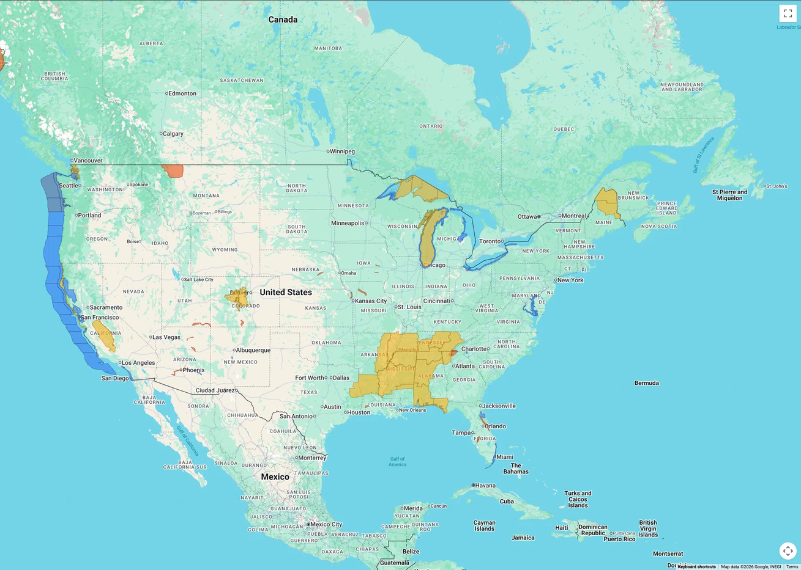

```text
                       .
                      / \
                     /   \
                    /_____\
           ~~~~~~~~~~~~~~~~~~~~~~~~
         ~~~~~~~   (0°, 0°)   ~~~~~~~
           ~~~~~~~~~~~~~~~~~~~~~~~~
                  ~           ~
```

# nullisland

[](https://www.npmjs.com/package/@offthemap/nullisland)
[](LICENSE)

**ArcGIS layers on Google Maps.** Point it at a `MapServer` or `FeatureServer` URL and it draws that
layer on your map — PBF features when the service serves them, a server-rendered image when it
doesn't. Public layers need no token.



*The demo, drawing the public NWS watches and warnings service on Google Maps.*

## Why

- **PBF first.** One binary request per viewport instead of a GeoJSON document; falls back to GeoJSON
  or Esri JSON only when a server needs it.
- **Works without CORS.** Export images load through `` instead of `fetch`, so services that
  don't send CORS headers still render.
- **Viewport only.** Queries snap to the tile grid, cache what they fetch, and abort when the map
  moves on.
- **No token by default.** ArcGIS authentication is opt-in, with automatic retry on 498/499.
- **GPU for vector tiles.** MVT tiles are triangulated once and drawn with WebGL; canvas is the
  fallback.
- **No runtime dependencies.** ESM and CJS builds with TypeScript types.

## Install

```bash
npm install @offthemap/nullisland
```

The Google Maps JavaScript API must be loaded before you create the engine.

## Usage

```ts
import {NullIsland} from '@offthemap/nullisland';

const arc = new NullIsland({
  map,
  layers: [
    {
      // A FeatureServer: rendered as PBF features in a Data layer.
      url: 'https://sampleserver6.arcgisonline.com/arcgis/rest/services/ServiceRequest/FeatureServer',
      color: '#e4572e',
    },
    {
      // A MapServer: the server renders the image.
      url: 'https://sampleserver6.arcgisonline.com/arcgis/rest/services/USA/MapServer',
      opacity: 0.6,
    },
  ],
  indicator: true,
});

arc.on('error', console.error);
await arc.ready;
```

Public layers need no token. Pass `apiKey` only for services that require authentication.

## Demo

`demo/` renders the public NWS watches and warnings service, and is what the screenshot above shows.
Google's JS API requires a key, so the page asks for one at runtime — nothing is committed, and the
ArcGIS layer itself needs no token.

```bash
npm run build:demo   # bundle src/ into demo/nullisland.js
npx serve demo
```

## How it works

Each layer picks its own strategy:

| Service | Strategy |
| --- | --- |
| MapServer with the `Map` capability | **Export** — a server-rendered PNG placed over the map |
| FeatureServer (or MapServer without export) | **Vector** — features drawn in a `google.maps.Data` layer |

Vector layers query only the visible viewport, prefer `f=pbf`, fall back to GeoJSON then Esri JSON,
cache tile-aligned results, and abort requests the user has already panned past.

### Vector tile services

Pass a `.../VectorTileServer` URL. Discovery reads its `tileInfo` and `resources/styles/root.json`,
tiles decode as MVT, and each tile is triangulated once (earcut) and drawn through a WebGL painter —
one draw call per tile per style layer. If WebGL2 is unavailable the canvas painter is used; force
either with `renderer: 'webgl' | 'canvas'` on the layer.

MVT paint support is limited to fill and line colours/widths with literal values. Labels and feature
picking are not implemented yet.

## API

### `new NullIsland(options)`

| Option | Type | Default | Description |
| --- | --- | --- | --- |
| `map` | `google.maps.Map` | — | Required. |
| `layers` | `ArcGisLayerConfig[]` | — | Required. |
| `apiKey` | `string \| () => string \| Promise<string>` | — | Optional. Only for services that require auth. |
| `google` | `typeof google` | `globalThis.google` | Inject the Maps namespace. |
| `padding` | `number` | `0.25` | Extra viewport coverage. |
| `maxImageSize` | `number` | `4096` | Export size cap. |
| `cacheSize` | `number` | `8` | Viewports cached per vector layer. |
| `fadeDuration` | `number` | `150` | Export cross-fade, ms. |
| `reducedMotion` | `boolean` | OS setting | Disable cross-fade. |
| `indicator` | `boolean \| HTMLElement` | `false` | Built-in loading pill, or your own element. |
| `fetch` | `typeof fetch` | global | Custom fetch for proxying or instrumentation. |
| `exportTransport` | `'image' \| 'fetch'` | `'image'` | Image element (no CORS) or blob via fetch (needs CORS). |
| `exportTimeout` | `number` | `20000` | Per-image timeout, ms. |
| `allowInsecure` | `boolean` | `false` | Permit plain `http:` URLs; localhost is always allowed. |

### Layer config

| Option | Type | Default | Description |
| --- | --- | --- | --- |
| `url` | `string` | — | Service root or single layer URL. |
| `id` | `string` | derived | Stable id, used by `arc.getLayer(id)`. |
| `title` | `string` | service name | Display name. |
| `color` | `string \| [r,g,b,a]` | renderer | Overrides the service symbology. |
| `opacity` | `number` | `1` | 0–1. |
| `minZoom` / `maxZoom` | `number` | service scales | Google Maps zoom gate. |
| `visible` | `boolean` | `true` | Initial state. |
| `mode` | `'auto' \| 'export' \| 'vector'` | `'auto'` | Force a strategy. |
| `sublayers` | `number[]` | all | MapServer sublayer ids to include. |
| `styleUrl` | `string` | service root.json | Style document for a `VectorTileServer`. |
| `renderer` | `'auto' \| 'webgl' \| 'canvas'` | `'auto'` | Painter for MVT sources. |
| `maxFeatures` | `number` | `20000` | Per-viewport feature cap. |
| `maxPages` | `number` | `10` | Per-viewport page cap. |

### Instance

```ts
arc.ready;                                   // Promise<void>
arc.layers;                                  // readonly NullIslandLayer[]
arc.getLayer('parcels');                     // NullIslandLayer | undefined
arc.prefetch('parcels');                     // warm the current viewport
arc.refresh('parcels');                      // drop cache and reload
arc.setApiKey('token');
arc.on('status' | 'error' | 'load', fn);     // returns an unsubscribe function
arc.destroy();
```

A layer handle has `setVisible()`, `setOpacity()`, `prefetch()` and `refresh()`.

### Authentication

Public layers work as-is. For a service that enforces auth:

```ts
const arc = new NullIsland({
  map,
  apiKey: async () => (await fetch('/arcgis-token')).json().then((r) => r.token),
  layers: [{url: 'https://internal.example.com/arcgis/rest/services/Parcels/FeatureServer'}],
});
```

## Notes

- **Browser only.** Requires the Google Maps JavaScript API; there is no headless or server mode.
- **No token by default.** `apiKey` is only for services that require it.
- **HTTPS only**, except localhost; set `allowInsecure: true` for an internal HTTP server.
- **Vector ceiling.** `google.maps.Data` is comfortable with a few thousand features, not tens of
  thousands.
- **Export is raster.** No client-side styling, picking or querying.
- **MapServer has no PBF.** Those layers use GeoJSON, or Esri JSON on older servers.
- **MVT is fill/line only.** No labels, no picking, and one style colour per source layer.
- **No MVT.** For a `VectorTileServer`, use deck.gl's `MVTLayer` over `GoogleMapsOverlay`.

## Design notes

Thresholds, caching and the tradeoffs behind them: [docs/design.md](docs/design.md).

## License

MIT
